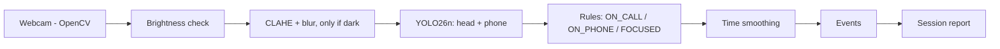

# Focus Coach: Detecting Phone Use While Studying with a Webcam, YOLO26 and Simple Rules

Computer Vision mini project, Karnavati University, Semester VII (Course 71407001002 / 73407001002)

Student: [AUTHOR: name and enrolment number]  
Guide: [GUIDE: name]

All numbers in this report are generated from the result files in `results/` by `report/build_report.py`.

## 1. Abstract

Studying with a phone nearby invites interruptions. This project builds Focus Coach, a desktop application that watches a laptop webcam and counts how often the user picks up a phone. A YOLO26n detector, fine-tuned on the FPI-Det dataset, finds heads and phones. Geometric rules turn the boxes into the states focused, on phone and on call, and a {{window_s}}-second time window turns frame states into events and a session report. Fine-tuning raised phone mAP50 on the test split from {{det_phone_coco_map50}} to {{det_phone_ft_map50}}. On {{n_held}} held-out images the rules reached {{b_rules_acc}} accuracy, level with the simpler check "any phone found" ({{a_ft_acc}}) and well above a MobileNetV2 classifier ({{c_mobilenet_acc}}). CLAHE with a light blur helped on dim images but not on near-black ones. The processing pipeline runs at {{app_fps_640}} frames per second on a laptop CPU. Time smoothing was demonstrated, not measured.

## 2. Introduction

A phone within reach is one of the most common causes of broken concentration while studying. Apps that report screen time only know what happens on the phone; they cannot tell whether the phone was picked up during a study hour or how long the interruption lasted. A camera on the desk can see the behaviour directly.

Detecting a phone in the picture is not enough. A phone lying on the desk is visible, but it is not in use. What matters is the relation between the phone and the person: held at the ear, held in front of the face, or lying far away. This project therefore detects two things, the head and the phone, and decides the usage state from their positions.

The aims were:

1. to fine-tune a small, fast object detector (YOLO26n) on a public phone-use dataset and measure the gain over the pre-trained model;
2. to turn the detections into usage states with simple, explainable rules, and to compare them with simpler and with learned alternatives;
3. to test whether classical image enhancement helps the detector in low light;
4. to build a working desktop application with OpenCV that counts phone pickups over a session and produces a report.

## 3. Syllabus mapping

| Part of the project | Unit | Practical | Course outcome |
|---|---|---|---|
| Webcam capture, frame pipeline, drawing the interface | Unit I: CV pipeline, image acquisition, OpenCV basics | | [CO: fill from the syllabus] |
| Brightness check, global histogram equalization, CLAHE, Gaussian smoothing, low-light experiment | Unit II: histogram equalization, filtering | Practical 2 | [CO: fill from the syllabus] |
| Fine-tuned YOLO26n for head and phone | Unit III: YOLO object detection | Practical 6 | [CO: fill from the syllabus] |
| Transfer learning, fine-tuning, MobileNetV2 baseline; accuracy, IoU, mAP | Unit IV: transfer learning, MobileNet, metrics | Practical 8 | [CO: fill from the syllabus] |
| Usage states, time smoothing, the Focus Coach application | Unit V: activity recognition, real-world case studies | | [CO: fill from the syllabus] |
| The whole project | | Practical 11: Research Project | [CO: fill from the syllabus (CO1 to CO5)] |

## 4. Related work

**Dataset.** FPI-Det [1] is a dataset of images annotated for phone use, with boxes for heads (the faces are masked in the released images) and phones, and an image-level label for whether the person is using a phone. Its authors report it was published at ICASSP 2026, according to the dataset repository. It is the only dataset used here.

**Object detection.** YOLO [2] showed that detection can be done in a single pass of a convolutional network. We use YOLO26n, the smallest model of the Ultralytics YOLO26 family [CITE: Ultralytics YOLO26 documentation or paper, with the version used]. A model pre-trained on COCO [3] is the starting point for transfer learning. COCO has a "cell phone" class but no "head" class.

**Image classification with transfer learning.** MobileNetV2 [4] is a small convolutional network designed for phones and laptops, and is usually pre-trained on ImageNet [5]. Replacing its final layer and training on a new task is the standard transfer-learning recipe, which we use as the learned baseline.

**Contrast enhancement.** Histogram equalization stretches the intensity histogram of an image. Contrast-limited adaptive histogram equalization (CLAHE) [6] does this per tile and limits the amplification, which keeps noise under control. [CITE: course textbook chapter on histogram equalization and filtering]

## 5. Method

Figure 1 shows the pipeline.

*Figure 1. The Focus Coach pipeline.*

### 5.1 Image acquisition and preprocessing

The application reads frames with OpenCV's `VideoCapture` (the DirectShow backend on Windows), asking the camera for 1280 × 720 pixels. A separate thread keeps only the latest frame, so if detection is slower than the camera, old frames are dropped and the picture never lags. For every frame the mean brightness of the grey-scale image (0 to 255) is computed. The detector then resizes the frame to {{train_imgsz}} pixels on the long side, keeping the aspect ratio.

### 5.2 Low-light enhancement

Three enhancement methods were implemented with OpenCV (Unit II):

- **Global histogram equalization** on the luminance channel (Y of YCrCb), so colours are not shifted.
- **CLAHE** on the lightness channel (L of LAB), with a clip limit and a tile grid.
- **CLAHE followed by a Gaussian blur** ({{smooth_ksize}} × {{smooth_ksize}}), because CLAHE also amplifies noise.

The CLAHE settings (clip limit {{clahe_clip}}, tiles {{clahe_tiles}}) and the method were chosen on a sample of {{val_sample}} validation images that were darkened artificially, not on the test images. The application applies the chosen method ({{app_method}}) only when the mean brightness of a frame is below {{app_threshold}}; the reason for this threshold is given in Section 7.3.

### 5.3 Object detection with YOLO26n

YOLO26n was started from weights pre-trained on COCO (transfer learning) and fine-tuned for two classes, `phone` and `head`, on the FPI-Det training split ({{train_images}} images, {{train_phone_boxes}} phone boxes and {{train_head_boxes}} head boxes). Training ran for {{train_epochs}} epochs on a {{train_gpu}} GPU in Google Colab ({{train_hours}} hours) with image size {{train_imgsz}}, batch size {{train_batch}} and seed {{train_seed}}. The built-in augmentations were used: {{train_aug}}. The checkpoint with the best validation score was kept.

All inference in this project uses the default Ultralytics prediction path. YOLO26 has two output heads: a one-to-many head followed by non-maximum suppression (NMS), and a one-to-one head that needs no NMS. The default path uses the first, and that is what was used for every number in this report. The NMS-free mode was not evaluated.

### 5.4 Usage rules

The rules use only the boxes. For the user's head box H (width w, height h) and each phone box P:

- **ON_CALL:** P overlaps H grown by {{head_expand}} of its width and height on every side. The phone is at the ear or face.
- **ON_PHONE:** the centre of P is below the centre of H, within {{max_dx}} head widths sideways and {{max_dy}} head heights downward. The phone is held in front.
- **FOCUSED:** anything else, including no phone.

ON_CALL is checked first. In still images every head is judged (a photo can show several people), each phone belonging to the nearest head. In the application only the largest head counts, because the webcam is closest to the user.

*Figure 2. The rules drawn on a photo with the tuned values.*

The thresholds were chosen by a grid search over {{grid_size}} combinations on the tune split only (Section 6), maximising the F1 score of "using a phone". Table 1 shows the values used.

*Table 1. Tuned rule and smoothing settings (`shared/rules.json`).*

{{table_rules}}

### 5.5 Time smoothing as simple activity recognition

A single frame can be wrong, and a half-second glance at the phone is not a pickup. Frame states are therefore smoothed over time (Unit V). A state is shown only when it fills at least {{enter_pct}} of the last {{window_s}} seconds, measured in time and not in frames, so it works at any frame rate. Otherwise the previous state stays. A shown state therefore appears about {{lag_s}} seconds after it really starts and ends about as late after it stops, so durations are nearly unaffected. If no head is found for more than {{away_s}} seconds the state is AWAY, which is not counted as phone time.

Entering ON_PHONE or ON_CALL starts a distraction event and leaving it ends the event. The step from ON_PHONE to ON_CALL is one pickup but two events. A session report lists the events and totals (Section 8).

### 5.6 Baseline: MobileNetV2 transfer learning

As the textbook alternative, a MobileNetV2 network pre-trained on ImageNet looks at the whole image, shrunk to 224 × 224, and predicts "using a phone" directly (Unit IV). A new output layer (global average pooling, dropout 0.3, one sigmoid unit) was trained in two stages: first with the backbone frozen ({{mn_epochs1}} epochs), then with the top {{mn_unfrozen}} layers also trained at a small learning rate ({{mn_epochs2}} epochs). Augmentation was flip, small rotation, brightness and contrast jitter. It was trained on the tune split only ({{mn_train}} training and {{mn_val}} validation images; the classes are imbalanced {{mn_ratio}} to 1, so class weights were used), with decision threshold {{mn_threshold}}.

## 6. Experiments

### 6.1 Data and splits

FPI-Det comes with training, validation and test images with boxes. Table 2 shows their sizes. Some images have no box at all: {{val_no_box_images}} of the {{val_images}} validation images, but only {{test_no_box_images}} of the {{test_images}} test images.

*Table 2. FPI-Det detector splits after label cleaning.*

{{table_dataset}}

*Figure 3. Training images with boxes, and the size of the boxes.*

The image-level usage label (`label.csv`) exists only for the validation and test images, together {{n_held_plus_tune}} images. This is the only ground truth for "using a phone", and it is used for both tuning and reporting, so it was split once, randomly but with a fixed seed (42), into a 30% **tune** part and a 70% **held-out** part, keeping the mix of validation and test images and of "using" and "not using" the same in both (Table 3). All thresholds were chosen on the tune part. The held-out part was used only to report results, and no setting was changed after the held-out numbers were seen.

*Table 3. Usage-label splits.*

{{table_splits}}

One known leak: about 42% of the label.csv images are validation images, which were also used to select the best detector checkpoint. The held-out numbers are therefore slightly optimistic.

### 6.2 Methods compared for usage classification

- **A-coco:** any phone found by the COCO model means "using".
- **A-ft:** the same with the fine-tuned model.
- **A2-authors:** the FPI-Det authors' own decision logic (a head and a phone both found) applied to our detections.
- **B-rules:** our geometric rules.
- **C-mobilenet:** the MobileNetV2 classifier.

For A-coco and A-ft the phone confidence threshold was also tuned on the tune split ({{tune_baseline_coco_conf}} and {{tune_baseline_ft_conf}}), so that the comparison with B-rules is fair.

### 6.3 Metrics

- **Accuracy:** the share of images classified correctly.
- **Precision:** of the images predicted "using", the share that really are.
- **Recall:** of the images that really are "using", the share found.
- **F1:** the harmonic mean of precision and recall.
- **IoU** (intersection over union): the overlap of a predicted box and the true box divided by their combined area. A detection counts as correct at IoU 0.5 or more.
- **mAP50:** the mean average precision, the area under the precision-recall curve, with a detection counted correct at IoU 0.5. **mAP50-95** averages this over IoU thresholds from 0.5 to 0.95 and rewards tighter boxes.

mAP was computed with the torchmetrics library, and the usage metrics were also recomputed with the FPI-Det authors' own `calculate_metrics.py`; the two agreed to four decimals for all methods.

### 6.4 Hardware

Training ran on a {{train_gpu}} GPU in Google Colab. All evaluation and the application ran on a laptop CPU ({{cpu}}) without a GPU.

## 7. Results

### 7.1 Detection

*Table 4. Detection on the test split ({{n_test}} images). Precision, recall and IoU are measured at each model's tuned confidence ({{det_phone_coco_conf}} for COCO phone, {{det_phone_ft_conf}} for fine-tuned phone, {{det_head_conf}} for head); mAP uses all detections.*

{{table_detection}}

Fine-tuning raised phone mAP50 from {{det_phone_coco_map50}} to {{det_phone_ft_map50}}, and the boxes of correct detections overlap the true boxes better (mean IoU {{det_phone_coco_iou}} against {{det_phone_ft_iou}}). The COCO model cannot detect heads at all.

*Table 5. Phone mAP50 by box size on the test split.*

{{table_by_size}}

*Figure 5. Phone mAP50 by box size.*

Small phones are the hardest for both models. The head mAP50 on the test split is {{det_head_map50}}, but on the validation split it was only {{val_head_map50}} (phone: {{val_phone_map50}}). A likely reason is that many validation images contain heads without a box ({{val_no_box_images}} images have no box at all), which turns correct detections into false positives; this was not tested directly.

*Figure 4a. Training curves.*

*Figure 4b. The COCO model and the fine-tuned model on the same images.*

### 7.2 Usage classification

*Table 6. Usage classification on the held-out images (n = {{n_held}}, {{held_using_rate}} using a phone).*

{{table_classification}}

*Figure 6. Confusion matrices of A-ft, B-rules and C-mobilenet.*

Three results stand out. First, using the detector at all matters: the COCO model reaches only {{a_coco_acc}} accuracy, the fine-tuned one {{a_ft_acc}}. Second, the geometric rules ({{b_rules_acc}}) do not beat the simple check "any phone found" ({{a_ft_acc}}); the two are level within a few thousandths. This was a surprise, because the rules were expected to remove false alarms from phones lying away from the person. On these photos a visible phone already predicts the label well: {{phone_box_rate_using}} of the "using" images contain a phone box, against {{phone_box_rate_not_using}} of the "not using" images. The value of the rules is that they separate ON_CALL, ON_PHONE and FOCUSED, which the application needs and which "any phone found" cannot give. Third, the whole-image MobileNet baseline is clearly worse ({{c_mobilenet_acc}}); see Section 7.4.

### 7.3 Low-light study

Dim and dark copies of the test images were made by scaling brightness, applying gamma and adding noise (dim: median brightness {{bright_dim_median}} of 255, dark: {{bright_dark_median}}, original: {{bright_orig_median}}). The {{n_real_dark}} darkest original test images (brightness up to {{bright_real_dark_max}}) form a "real dark" subset that does not depend on the artificial recipe.

*Table 7. Detector mAP50 on the test split, phone / head, by lighting and enhancement.*

{{table_lowlight}}

*Figure 8a. A dark image with each enhancement and its histogram.*

*Figure 8b. mAP50 by lighting and enhancement.*

*Table 8. B-rules usage classification on the held-out images under different lighting.*

{{table_lowlight_usage}}

{{lowlight_notes}}

From this the application enhances only frames whose mean brightness is below {{app_threshold}} with {{app_method}}, the brightness range of the dim images where it helped by {{dim_gain_phone}} points of phone mAP50.

### 7.4 MobileNetV2 baseline

*Figure 9a. Training curves of the MobileNetV2 baseline.*

MobileNet and B-rules disagree on {{mn_disagree}} held-out images: MobileNet alone is right on {{mn_only_right}}, B-rules alone on {{rules_only_right}}.

*Figure 9b. Images where MobileNet and B-rules disagree.*

{{mobilenet_notes}}

### 7.5 Speed

*Table 9. Speed on {{cpu}}. The app pipeline includes the enhancement check, detection, rules, smoothing and drawing, but not the camera or the window.*

{{table_speed}}

The pipeline is fast enough for live use. A real webcam can deliver fewer frames than this, for example when it lengthens its exposure in dim light, so the live frame rate shown by the application depends on the camera. Live frame rates were not measured for this report.

### 7.6 Failure analysis

B-rules made {{fp}} false alarms ({{fp_on_phone}} as ON_PHONE, {{fp_on_call}} as ON_CALL) and {{fn}} misses on the held-out images. Of the misses, {{fn_no_phone}} ({{fn_no_phone_pct}}) had no phone detected at all.

*Figure 7a. The most confident false alarms.*

*Figure 7b. The most confident misses.*

{{failure_notes}}

## 8. Application: Focus Coach

Focus Coach is a desktop application built with OpenCV. It opens the webcam (or a video file), and the user controls it with the keys **S** (start, pause, resume), **E** (end the session and show the report), **D** (show the detection boxes), **C** (cycle the low-light enhancement: automatic, on, off) and **Q** (quit). A banner shows the current state, with counters for elapsed time, pickups, phone time and the current focus streak. The footer shows the frame rate, the inference time and whether enhancement is on.

[SCREENSHOT 1: the live window while FOCUSED, with the tip text before the session starts]  
[SCREENSHOT 2: the live window ON PHONE with debug boxes (press D)]  
[SCREENSHOT 3: the live window in low light with "Low light: CLAHE on" in the footer]

At the end of a session the application writes `events.csv`, `summary.json` and `report.png` to a folder named after the start time. The report shows the share of time focused, the phone time, the number of pickups, the longest focus streak, the average distraction length, the time away, and a timeline coloured by state. Figure 10 is a sample produced by the application's own code on a scripted test clip built from real photos (focused, a five-second phone pickup, a half-second glance that is correctly ignored, a five-second call, and a covered camera). It is a test of the application, not a real study session.

*Figure 10. Sample session report from a scripted test clip.*

An optional browser demo (`demo/`, built with Gradio) runs the same model, rules, smoothing and report code from a Google Colab notebook, with a live webcam tab, a video-upload tab and a single-photo tab. It is a new front end only and is not part of the measured results; the live tab sends every frame over the internet and is slower than the desktop application, which is why the video tab is the reliable mode.

Only event times and totals are saved. Video frames are processed in memory and are not stored unless the user starts the application with `--save-video`.

## 9. Limitations

- **Different camera view.** FPI-Det consists mostly of surveillance-style photos of people seen from above or from the side. The application uses a frontal laptop webcam. All thresholds were tuned on the photos, and the results say little about webcam accuracy.
- **Time smoothing was not measured.** There is no labelled webcam video, so the smoothing was demonstrated on a scripted clip but its accuracy (missed or invented pickups) was not measured. The live application was not part of the measured results.
- **Label noise.** Many photos with the same visible behaviour have opposite labels (Section 7.6), so part of the remaining error may be in the labels and not in the model.
- **Phones the camera cannot see.** A phone held below the desk or below the picture edge is invisible. A person looking down at a phone in their lap may also lose the head detection and be shown as AWAY.
- **One user.** Only the largest head is judged, so a second person close to the camera would confuse the result.
- **Low light has a limit.** Below a certain brightness no method recovered the detections (Section 7.3).
- **Small leak in the held-out numbers.** About 42% of the usage-labelled images were also used to choose the detector checkpoint (Section 6.1).
- **Test conditions.** The darkening used in the low-light study is a recipe, not a real dim room, and the method was chosen on the same recipe applied to validation images.

## 10. Ethics and privacy

Focus Coach is meant for self-monitoring by the person who runs it, with their consent. A camera that watches people must not be used to monitor others without their knowledge. In the application, frames are processed in memory and discarded. By default only event times and summary numbers are written to disk. Saving the annotated video is opt-in with a command-line option. The FPI-Det images show people with their faces masked and were used only for training and testing under the dataset's licence (MIT).

## 11. Future work

- Record a labelled set of webcam videos, so the smoothing window and the thresholds can be tuned and measured on the real use case.
- Evaluate the NMS-free output mode of YOLO26 for speed and accuracy.
- Add pose estimation (Unit V) to catch someone looking down at a phone below the camera's view.
- Re-tune the thresholds on webcam data; the head confidence in particular was tuned on photos.

## 12. References

[1] J. Gao, T. Wang, Y. Zhang, Y. Zhang, C. Wang, A. Dong and Z. Wang, "FPI-Det: a face–phone Interaction Dataset for phone-use detection and understanding," arXiv:2509.09111, 2025. [CITE: confirm the ICASSP 2026 proceedings details before submitting]

[2] J. Redmon, S. Divvala, R. Girshick and A. Farhadi, "You Only Look Once: Unified, Real-Time Object Detection," in Proc. IEEE Conf. Computer Vision and Pattern Recognition (CVPR), 2016.

[3] T.-Y. Lin et al., "Microsoft COCO: Common Objects in Context," in Proc. European Conf. Computer Vision (ECCV), 2014.

[4] M. Sandler, A. Howard, M. Zhu, A. Zhmoginov and L.-C. Chen, "MobileNetV2: Inverted Residuals and Linear Bottlenecks," in Proc. IEEE Conf. Computer Vision and Pattern Recognition (CVPR), 2018.

[5] J. Deng, W. Dong, R. Socher, L.-J. Li, K. Li and L. Fei-Fei, "ImageNet: A large-scale hierarchical image database," in Proc. IEEE Conf. Computer Vision and Pattern Recognition (CVPR), 2009.

[6] K. Zuiderveld, "Contrast Limited Adaptive Histogram Equalization," in Graphics Gems IV, P. S. Heckbert, Ed. Academic Press, 1994, pp. 474–485.

[7] [CITE: Ultralytics YOLO26 documentation or paper]
